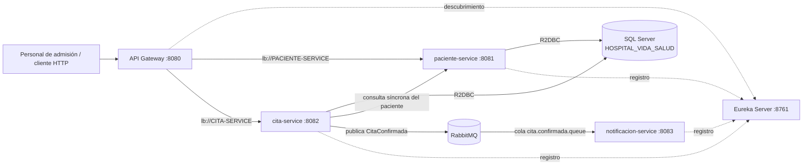
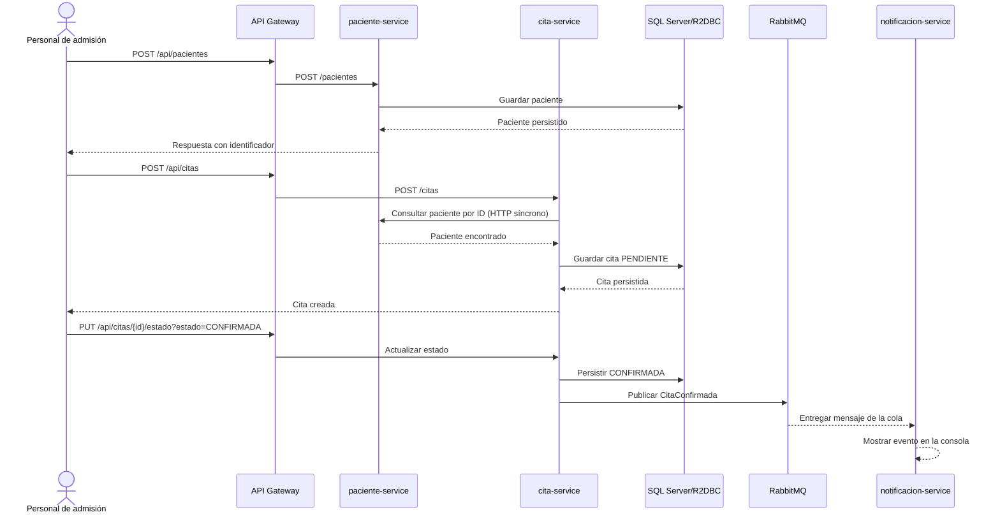

# Hospital Vida Salud — Documento técnico T2

**Curso:** Desarrollo de Aplicaciones Web II  
**Caso:** Hospital Vida Salud  
**Repositorio:** https://github.com/carlosantonio-cpu/HOSPITAL_VIDA_SALUD_T2  
**Tipo de solución:** Prototipo académico basado en microservicios y datos ficticios.

## 1. Problema y alcance

El caso plantea modernizar una aplicación hospitalaria monolítica para separar responsabilidades, permitir despliegues independientes, reducir el acoplamiento y automatizar la compilación y las pruebas. El prototipo implementa un flujo vertical centrado en el registro de pacientes, la programación y confirmación de citas y la notificación asíncrona de una cita confirmada.

El enunciado permite que los procesos hospitalarios seleccionados no tengan todos la misma profundidad, siempre que se justifique el alcance y se demuestre al menos un flujo funcional de extremo a extremo. Por ello, laboratorio, hospitalización, farmacia y pagos no se consideran implementados en esta versión.

## 2. Actores

- **Personal de admisión:** registra y consulta pacientes y citas.
- **Personal administrativo:** confirma, cancela o actualiza el estado de una cita, según las transiciones permitidas.
- **Administrador del sistema:** verifica los servicios registrados en Eureka y las ejecuciones de integración continua.
- **Equipo de desarrollo:** mantiene el código y el workflow de GitHub Actions.

Los datos de ejemplo son ficticios; el sistema no diagnostica ni recomienda tratamientos.

## 3. Arquitectura



### Componentes y responsabilidades

| Componente | Puerto local | Responsabilidad principal |
|---|---:|---|
| `eureka-server` | 8761 | Registro y descubrimiento de instancias. |
| `api-gateway` | 8080 | Punto de entrada; enruta las rutas `/api/pacientes/**` y `/api/citas/**`. |
| `paciente-service` | 8081 | Alta, consulta y actualización de pacientes. Es propietario lógico de la entidad `pacientes`. |
| `cita-service` | 8082 | Alta, consulta y cambio de estado de citas. Es propietario lógico de la entidad `citas`. Consulta al servicio de pacientes antes de crear una cita. |
| `notificacion-service` | 8083 | Consume el evento de cita confirmada y muestra la información recibida en consola. |
| SQL Server | 1433 | Persistencia relacional de las tablas del prototipo. |
| RabbitMQ | 5672 | Transporte asíncrono del evento de confirmación. |

Para este prototipo académico se utiliza una misma base SQL Server con tablas separadas. La propiedad lógica de cada entidad corresponde a su servicio; las consultas al paciente desde el servicio de citas se realizan mediante la API HTTP del servicio de pacientes, no consultando su tabla directamente.

## 4. Flujo funcional implementado



La consulta HTTP de paciente es síncrona porque la creación de una cita necesita saber inmediatamente si el paciente existe. RabbitMQ se utiliza para la notificación secundaria, para no acoplar el productor al consumidor.

## 5. Modelo de datos

### `pacientes`

Campos principales: `id`, `tipo_documento`, `numero_documento`, `nombres`, `apellidos`, `fecha_nacimiento`, `telefono`, `correo`, `direccion`, `fecha_registro` y `estado`.

La base aplica una restricción única sobre `(tipo_documento, numero_documento)` y restringe el estado a `ACTIVO` o `INACTIVO`.

### `citas`

Campos principales: `id`, `paciente_id`, `especialidad`, `fecha_hora`, `profesional_codigo`, `motivo_administrativo`, `estado`, `fecha_creacion` y `fecha_actualizacion`.

Se define una restricción única sobre `(profesional_codigo, fecha_hora)` para impedir que el mismo profesional tenga dos citas al mismo horario. Las tablas se acceden con Spring Data R2DBC en los microservicios correspondientes.

## 6. Reglas de negocio de pacientes y citas

- El paciente debe tener tipo y número de documento, nombres y apellidos.
- No se debe duplicar el mismo tipo y número de documento; la API devuelve conflicto al detectar un duplicado.
- Una cita requiere paciente, especialidad, fecha/hora y código del profesional.
- Antes de crear una cita se consulta al servicio de pacientes para validar que el identificador exista.
- No se debe programar una cita en una fecha pasada.
- Los estados permitidos son `PENDIENTE`, `CONFIRMADA`, `ATENDIDA`, `CANCELADA` y `AUSENTE`.
- El servicio aplica transiciones de estado controladas; una cita cancelada no debe confirmarse.
- Las confirmaciones publican un evento de negocio en RabbitMQ.

Estas reglas deben verificarse con pruebas funcionales y con evidencia de respuestas válidas y rechazadas.

## 7. Contratos HTTP principales

### Pacientes — vía Gateway

| Método | Ruta | Propósito |
|---|---|---|
| `GET` | `/api/pacientes` | Listar pacientes. |
| `GET` | `/api/pacientes/{id}` | Consultar por identificador. |
| `POST` | `/api/pacientes` | Registrar paciente. |
| `PUT` | `/api/pacientes/{id}` | Actualizar datos/estado del paciente. |

Ejemplo de cuerpo para registrar un paciente (datos ficticios):

```json
{
  "tipoDocumento": "DNI",
  "numeroDocumento": "12345678",
  "nombres": "Ana",
  "apellidos": "Prueba",
  "fechaNacimiento": "1995-04-15",
  "telefono": "900000001",
  "correo": "ana@example.com",
  "direccion": "Direccion ficticia"
}
```

### Citas — vía Gateway

| Método | Ruta | Propósito |
|---|---|---|
| `GET` | `/api/citas` | Listar citas. |
| `GET` | `/api/citas/{id}` | Consultar por identificador. |
| `POST` | `/api/citas` | Registrar cita en estado pendiente. |
| `PUT` | `/api/citas/{id}/estado?estado=CONFIRMADA` | Solicitar un cambio de estado. |

Ejemplo de cuerpo (fecha futura y datos ficticios):

```json
{
  "pacienteId": 1,
  "especialidad": "Medicina General",
  "fechaHora": "2030-01-15T10:30:00",
  "profesionalCodigo": "MED-001",
  "motivoAdministrativo": "Cita de prueba"
}
```

Los errores deben revisarse por caso: solicitud incompleta, paciente inexistente, documento duplicado, fecha pasada y transición de estado no permitida.

## 8. Evento RabbitMQ

- **Exchange:** `hospital.exchange`
- **Routing key:** `cita.confirmada`
- **Cola:** `cita.confirmada.queue`
- **Productor:** `cita-service`
- **Consumidor:** `notificacion-service`
- **Evento:** `CitaConfirmadaEvent`, con identificador de cita, identificador de paciente, especialidad, fecha/hora y estado.

El consumidor demuestra el evento en los logs. No se envían mensajes reales por correo o SMS.

## 9. Tecnologías reactivas y persistencia

Los controladores de la API usan Spring WebFlux y tipos reactivos `Mono` y `Flux`; la persistencia está configurada mediante Spring Data R2DBC con SQL Server. `Mono` representa una respuesta de cero o un elemento y `Flux` una secuencia de elementos.

En la revisión técnica se debe prestar especial atención a no bloquear el hilo reactivo con llamadas `.block()` o suscripciones manuales dentro del flujo web. Si se usa una llamada síncrona, debe estar delimitada y justificada o cambiarse a composición reactiva no bloqueante.

## 10. Integración continua

El workflow se encuentra en `.github/workflows/ci.yml`. Se activa ante `push` y `pull_request` hacia `main` o `master`, y ejecuta las tareas `test` de los cinco proyectos:

- `eureka-server` (Maven)
- `api-gateway` (Maven)
- `paciente-service` (Maven)
- `cita-service` (Gradle)
- `notificacion-service` (Gradle)

En GitHub Actions se comprobó una ejecución exitosa de los cinco trabajos, una ejecución fallida por una prueba añadida intencionalmente y una ejecución exitosa después de restaurar la prueba original. El pipeline puede ejecutarse sin que SQL Server local esté disponible porque las tareas automatizadas actuales son pruebas de los proyectos, no una prueba end-to-end desplegada en infraestructura externa.

## 11. Ejecución local

Requisitos: JDK 21, SQL Server con la base `HOSPITAL_VIDA_SALUD`, RabbitMQ en el puerto 5672 y los puertos de los servicios disponibles.

Desde la carpeta de cada proyecto Maven (`eureka-server`, `api-gateway`, `paciente-service`):

```powershell
.\mvnw.cmd test
.\mvnw.cmd spring-boot:run
```

Desde cada proyecto Gradle (`cita-service`, `notificacion-service`):

```powershell
.\gradlew.bat test
.\gradlew.bat bootRun
```

Iniciar cada aplicación una sola vez. Si el puerto ya está ocupado, comprobar si el proceso correspondiente ya se está ejecutando antes de iniciarla nuevamente.

## 12. Seguridad y limitaciones

- Utilizar únicamente datos ficticios.
- No subir credenciales, tokens ni archivos `.env` con valores reales.
- Los valores de conexión se suministran mediante `DB_USERNAME`, `DB_PASSWORD`, `RABBITMQ_USERNAME` y `RABBITMQ_PASSWORD`.
- Los directorios `target` y `build` están excluidos mediante `.gitignore`.
- Laboratorio, hospitalización, farmacia y pagos son áreas fuera del alcance implementado de este prototipo y no deben presentarse como funcionalidades terminadas.
- Las pruebas de CI actualmente demuestran compilación y ejecución de pruebas de los proyectos; conviene complementar las pruebas de contexto con casos automatizados de reglas de negocio y endpoints.

## 13. Evidencias a adjuntar

Guardar capturas de:

1. Eureka con los servicios registrados.
2. Consultas de pacientes y citas a través del Gateway.
3. Rechazo de un paciente duplicado y rechazo de una transición inválida de estado.
4. Persistencia de los registros en SQL Server mediante R2DBC.
5. Evento publicado por `cita-service` y recibido por `notificacion-service`.
6. GitHub Actions en estado exitoso para los cinco trabajos.
7. Ejecución fallida controlada y ejecución exitosa posterior a la restauración.
8. Diagrama de arquitectura y diagrama del flujo funcional (incluidos en este documento).
